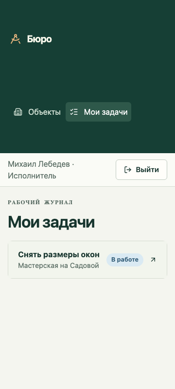
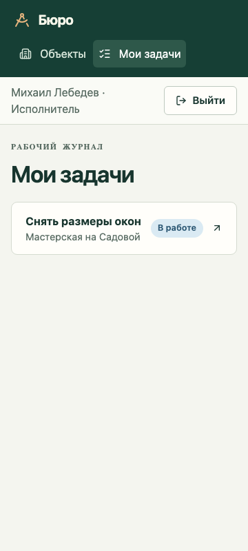

# Интерфейс «Объекты и задачи» · 4 ноября 2026

Проверены два рабочих маршрута. Постановщик находит объект, открывает задачу, назначает исполнителя и проверяет результат. Исполнитель находит своё поручение и меняет его статус. До правок сняты 11 состояний на каждом из двух размеров. После исправлений маршрут пройден заново. Ниже оставлены полноразмерные снимки по одному или двум характерным состояниям каждого шага.

## Что мешало работе

Список исполнителя, один и тот же viewport 360×800:

| До исправления | После исправления |
|---|---|
|  |  |

| Шаг | До исправления | Повторная проверка |
|---|---|---|
| Найти задачу на телефоне | При одной задаче мобильная навигация занимала 315 из 800 px высоты. | Шапка занимает 112 px, сразу под ней видны профиль, заголовок и поручение. [До](10-executor-mobile-before.png) · [после](10-executor-mobile-after.png) |
| Открыть запись с клавиатуры или касанием | После Enter фокус оказывался на body. В строке шириной 326 px ссылкой были только 157 px текста. | Вся строка открывает задачу. Фокус на заголовке называет открытую запись и даёт продолжить навигацию с этого места. [Объект](05-object-desktop-after.png) · [задача](08-task-mobile-after.png) |
| Создать задачу | Между полем и следующей подписью было 0 px. Из пяти полей обязательные выяснялись после отправки. Во время загрузки справочника исполнитель выглядел невыбранным. | Отступ 16 px. Инструкция перечисляет обязательные поля, у контролов есть required. Загрузка обозначена словами. При пустом списке исполнителей сохранение заблокировано, список можно обновить без закрытия формы. [До](06-task-form-mobile-before.png) · [после](06-task-form-mobile-after.png) · [ошибки полей](07-task-validation-desktop-after.png) |
| Различить ввод и пример адреса почты | Контраст контура поля с заливкой составлял 1,96∶1. Пример адреса в пустом поле имел контраст 2,89∶1. | В Chromium измерены 3,60∶1 и 5,63∶1 соответственно. Ошибочный select выделен контуром и связан с текстом ошибки. [Вход](01-login-desktop-after.png) · [ошибки задачи](07-task-validation-desktop-after.png) |
| Прочитать длинное значение | Неразрывный адрес занимал 1094 px в карточке шириной 282 px и обрезался. На маршруте задачи длинное имя объекта в обратной ссылке увеличивало ширину документа с 320 до 954 px. | Адрес переносится в пределах 282 px. Для имени объекта ширина документа и viewport совпали при 320 px. Проверка использует специально длинные значения в ответе браузеру. [До](12-long-name-320-before.png) · [после](12-long-name-320-after.png) |
| Отредактировать или удалить задачу | Кнопка удаления стояла первой и выглядела так же, как обычное действие. | Порядок, значки и оформление совпадают с карточкой объекта. Подтверждение называет задачу и последствия, первой в диалоге доступна отмена. [Карточка](08-task-desktop-after.png) · [подтверждение](09-confirm-mobile-after.png) |
| Понять результат смены статуса | При ожидании кнопка блокировалась без объяснения. При успехе она исчезала, отдельного сообщения о результате не было. | На время записи виден текст ожидания. После подтверждённого перехода появляется сообщение с названием статуса. Если фокус остался на исчезнувшем действии или на body, он переходит к сообщению. [Результат с клавиатурным фокусом](13-transition-mobile.png) |

## Маршрут проверки

1. **Вход.** Пустая форма сообщает об ошибках у обоих полей и ставит фокус на электронную почту. Ввод и пароль имеют постоянные подписи. [Desktop](01-login-desktop-after.png) · [mobile после отправки](02-invalid-login-mobile-after.png)
2. **Реестр и объект.** Карточки дают название, адрес и количество задач. Enter открывает объект. Из диалога создания Escape возвращает фокус на «Создать объект». [Реестр desktop](03-objects-desktop-after.png) · [реестр mobile](03-objects-mobile-after.png) · [диалог](04-object-form-mobile-after.png) · [объект](05-object-desktop-after.png)
3. **Постановка задачи.** Текущий объект предзаполнен. Пустая отправка сохраняет форму и объясняет, какие данные нужно добавить. В диалоге редактирования на 360×400 Shift+Tab достигает кнопок и прокручивает их в видимую область. [Форма](06-task-form-mobile-after.png) · [валидация](07-task-validation-desktop-after.png)
4. **Карточка постановщика.** Видны статус, объект, участники, дата и история. Редактирование предшествует удалению. Escape в подтверждении оставляет задачу на экране. [Desktop](08-task-desktop-after.png) · [mobile](08-task-mobile-after.png) · [удаление](09-confirm-mobile-after.png)
5. **Мои задачи.** После входа исполнитель попадает к своим поручениям. У каждой строки есть название объекта и текст статуса. В карточке есть действие, доступное исполнителю в текущем статусе. [Список](10-executor-mobile-after.png) · [карточка](11-executor-task-desktop-after.png)
6. **Работа и история.** При удержанном ответе нажатие Enter показывает ожидание. После получения нового статуса сообщение получает фокус. На снимке ответа и истории переход воспроизведён с подстановкой сетевого ответа в Chromium. За запись в настоящую БД и сравнение истории двух ролей отвечает [сквозной тест цикла](../../../e2e/cycle.spec.ts). [Снимок](13-transition-mobile.png)

## Проверки и пределы

- Исходная ревизия интерфейса — `978ad52`. Основные кадры сняты в Chromium с локальной production-сборки, реальными сессиями демо-постановщика и исполнителя при 1440×900 и 360×800. На всех 22 состояниях обычного маршрута ширина документа совпала с шириной viewport. Для проверок длинного имени и смены статуса использованы браузерные подстановки, для этих точечных итоговых кадров — локальный Vite с тем же изменённым кодом.
- В наблюдаемых тестах формы и навигации первоначально отсутствовали фокус заголовков, обязательность полей и статус загрузки справочника. После исправления `rtk proxy pnpm exec vitest run src/modules/objects/objects.test.tsx src/modules/tasks/tasks.test.tsx` дал 19/19. При усилении сценария перехода первый RED показал отсутствие статуса ожидания, промежуточный прогон воспроизвёл фокус на body после успеха. После правки `rtk proxy pnpm exec vitest run src/modules/tasks/tasks.test.tsx src/modules/tasks/recovery.test.tsx` дал 29/29.
- Геометрия, контраст двух пар цветов, роль сообщения и положение фокуса проверены отдельно от снимков по DOM браузера. Проверки списка, длинного адреса и подтверждения переходов входят в [регрессию списка](../../../e2e/recovery.spec.ts), [регрессию объекта](../../../e2e/access.spec.ts) и [сквозной цикл](../../../e2e/cycle.spec.ts).
- Реальные сенсорные устройства, экранная клавиатура ОС и чтение VoiceOver/NVDA в этой части аудита не проверялись. Снимок отдельного состояния не подтверждает запись в БД. Состояния полной приёмки и итоги общего прогона ведёт [план разработки](../../implementation-plan.md).

- На итоговой ревизии axe-core 4.10.3 проверил 11 состояний × 2 размера в Chromium. Автоматических нарушений не зарегистрировано. В некоторых состояниях оценка color-contrast осталась неполной; отдельно измеренные пары приведены в таблице. [Отчёт по каждому экрану](axe-results.json).
